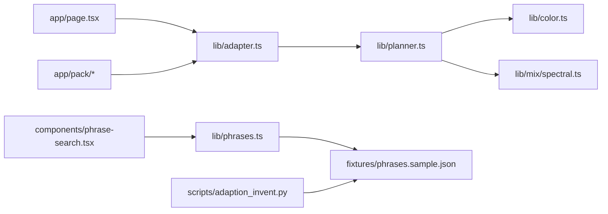

# Tubora

Tubora picks the few paint tubes to carry for one reference picture, gives a mixing recipe for every color in it, and lights up in red the parts those tubes will never reach. A painter who owns twelve tubes but has room for four finds out at home, not on the pier after the sky has gone to mud.

> Live: https://tubora.vercel.app, click **Pack my tubes** (DEMO step 1).

The live site runs the real planner on the seed scenes. The engine badge under the error readout names the mixer in its own words: "Live engine: spectral.js reflectance mixing, computed in your browser." when the deploy sets `ADAPTER_MODE=real`, and "Estimate engine: three-channel Kubelka-Munk. Spectral mixing is off in this build." otherwise. The phrase box serves "seed sample, awaiting Adaption run" rows until the Adaption run lands.

## Try it in 60 seconds

1. Open https://tubora.vercel.app and click **Pack my tubes** in the header or under the headline.
2. `/pack?scene=marmara-dusk` opens with the Marmara sunset loaded and the 12 student-set tubes ticked.
3. Slide the tube count to 5: the bag fills, and every color group gets a recipe and a mix swatch.
4. Slide down to 3: the stickers change, the red spreads across the sunset and the average error jumps. Click the planner's "Add <tube>" button and the error comes back down.

## Addresses

| What | Where |
| --- | --- |
| Live app | https://tubora.vercel.app |

## How the code fits



## The problem

A painter working outdoors, or anyone learning a limited palette (the Zorn four, say), owns twelve tubes but can carry four. Which four? Today you find out on site, after the sky has gone to mud.

The mixing apps we found (Undertint, Mixable, Real Paint mixing tools) answer one color at a time: tap a pixel, get a two or three tube recipe. Palette simulators go the other way and preview a palette you already chose. None of them chooses the subset of tubes for the whole picture.

## The solution

Tubora treats palette packing as an optimization problem over the entire reference:

1. **Cluster.** The image is scaled to 96 by 64 pixels and grouped into 24 colors with k-means in OKLab. Each group is weighted by how much of the canvas it covers.
2. **Mix.** Every 1, 2 and 3 tube combination of a 16-pigment catalog (PW6, PY35, PY42, PO20, PR108, PR101, PV19, PV23, PB29, PB15:3, PB35, PG18, PG17, PBr7 and friends) is mixed on a six-part grid with a Kubelka-Munk model: 6,216 candidate mixes. Which Kubelka-Munk model depends on the build, see "Mixing engine" below.
3. **Pick.** A greedy pass adds whichever owned tube cuts the picture's weighted CIEDE2000 error the most, until the bag holds `k` tubes.
4. **Show the gap.** Each color group is compared with the best mix the packed tubes can reach, and every pixel in it takes that error, so photo grain never counts against the palette. Any group more than 6 CIEDE2000 units off turns red. The same pass names the tube that would help most if you made room for it.

The demo moment: on the Marmara sunset with a 12-tube student set, slide from 4 tubes to 3 and the red spreads across the sunset. Click the planner's own "Add <tube>" suggestion and the error comes back down. The tube it names comes from the live engine; `npm run proof` writes it into `DEMO.md` step 4.

Every plan has its own URL (`/pack/marmara-dusk.k4.<owned-mask>` or a saved slug like `/pack/marmara-dusk-four-tubes`) with a copy-link button and a "Download palette card" button: one A6 PNG for the field bag with the packed tubes, the top 8 recipes and the heatmap thumbnail.

There is also a **"describe a color"** box. Type "karın üstünde akşam gölgesi" or "evening shadow on snow" and Tubora finds the closest painter phrase, then mixes it from the tubes you packed.

## Mixing engine

The planner builds its mix table with one of two engines, chosen by `ADAPTER_MODE` on the server and passed to the browser as a plain prop. The workspace and every shared plan page name the engine in a badge under the error readout.

- `ADAPTER_MODE=real`: **spectral.js** (`lib/mix/spectral.ts`). Each tube's sRGB color becomes a reflectance curve, the curves mix with Kubelka-Munk, and the result comes back to sRGB. Blue and yellow land on green the way paint does.
- `ADAPTER_MODE=fake` (the default): a three-channel Kubelka-Munk estimate written from scratch (`kmMix` in `lib/color.ts`). It runs anywhere and stays as the fallback engine.

Both engines feed the same planner code and the same screens. Each table is built once per engine and kept in memory. No key is needed for either.

<!-- PROOF:BEGIN mix-engine -->
Ultramarine Blue and Cadmium Yellow Light, 1:1. Hue is the OKLab hue angle (green sits near 140°).

| Engine | Mix | Hue | Mixes in table | Table build (ms) |
| --- | --- | --- | --- | --- |
| km-rgb | rgb(47, 54, 7) | 118° | 6216 | 52 |
| spectral | rgb(119, 146, 61) | 124° | 6216 | 163 |

spectral.js answered every spectral mix in this run.
<!-- PROOF:END mix-engine -->

The demo moment in numbers (`npm run proof` fills this in):

<!-- PROOF:BEGIN wow-numbers -->
Dusk over the Sea of Marmara, 12-tube student set.

| Engine | Tubes | Avg error (CIEDE2000) | Out of reach | Suggestion |
| --- | --- | --- | --- | --- |
| km-rgb | 5 | 5.99 | 43.0% | Cadmium Orange, error drops to 4.3 |
| km-rgb | 4 | 6.83 | 48.1% | Cadmium Orange, error drops to 5.7 |
| km-rgb | 3 | 9.24 | 66.2% | Cadmium Orange, error drops to 7.1 |
| spectral | 5 | 3.65 | 10.6% | none |
| spectral | 4 | 4.28 | 33.0% | Yellow Ochre, error drops to 3.7 |
| spectral | 3 | 5.93 | 53.1% | Cadmium Red Light, error drops to 4.3 |
<!-- PROOF:END wow-numbers -->

The six demo steps on the real engine, timed (`npm run proof` fills this in):

<!-- PROOF:BEGIN demo-path -->
The DEMO.md steps on the spectral engine, Marmara dusk, 12-tube student set. Step 5 uses the keyword matcher because the embedding model runs only in the browser.

| Step | File | Engine | Result | ms |
| --- | --- | --- | --- | --- |
| 2 | `components/pack-workspace.tsx` | spectral | 24 color groups, 6216 mixes | 282 |
| 3 | `components/pack-workspace.tsx` | spectral | 5 tubes, average error 3.6, 10.6% out of reach | 73 |
| 4 | `components/pack-workspace.tsx` | spectral | k=3: average error 5.9, 53.1% out of reach, suggests Cadmium Red Light, error drops to 4.3 | 53 |
| 5 | `components/phrase-search.tsx` | keyword | "karın üstünde akşam gölgesi" (score 1.00), mix Ochre 1 : Quin Rose 1 : Ultramarine 4 | 4 |
| 6 | `app/pack/[palette]/page.tsx` | spectral | 4 tubes, 24 recipes, average error 4.3 | 344 |

Out of reach by tube count (spectral): k=2 80.5%, k=3 53.1%, k=4 33.0%, k=5 10.6%, k=6 10.6%, k=7 4.8%.
<!-- PROOF:END demo-path -->

Tests:

<!-- PROOF:BEGIN tests -->
`npx tsx --test tests/mix.test.ts`: 7 passed, 0 failed.
<!-- PROOF:END tests -->

## How it uses the sponsor tech

| Bounty | Prize | Slots | Required tech | Code file | DEMO step |
| --- | --- | --- | --- | --- | --- |
| Adaption AI Application Award | $1,000 in Adaption credits for each team member; Adaption swag | 1 | Adaption | `scripts/adaption_invent.py` (generation), `lib/phrases.ts` (corpus selection), `components/phrase-search.tsx` (screen) | 5 |

The prize wording on the event page, verbatim: "$1,000 in Adaption credits for each team member; Adaption swag". The page publishes no separate qualification text for this award; we read the name as "an AI application that uses the Adaption product", and we are asking on Discord whether it needs an opt-in.

**Adaption (Adaption AI Application Award).** The phrase box searches a multilingual set of painter color phrases (English, Turkish, Spanish), each labelled with a target color, hue family, value and chroma. That set is generated with **Adaption Invent** by `scripts/adaption_invent.py`: it estimates the credit cost with `datasets.invent(..., estimate=True)`, runs the real invent as an instruction dataset, waits for it, reads `datasets.get_evaluation` (score before, score after, improvement), downloads JSONL, validates every row, and writes `fixtures/phrases.sample.json` and `fixtures/adaption-evaluation.sample.json` directly. `activePhrases()` in `lib/phrases.ts` then serves the Adaption rows instead of the seed rows, and the phrase box prints "Adaption evaluation: score X to Y (+Z%)" under every Adaption match (`/how` shows the same numbers).

Depth: delete `scripts/adaption_invent.py` and nothing can produce the `adaption-invent` rows or the evaluation. Delete those rows from `fixtures/phrases.sample.json` and DEMO step 5 falls back to the "seed sample, awaiting Adaption run" badge, and the evaluation line disappears from `/pack` and `/how`.

Status today: `fixtures/phrases.sample.json` holds the 18 hand-written seed rows (`source: "seed-sample"`) and no Adaption rows; `fixtures/adaption-evaluation.sample.json` says `"status": "pending"` with no scores. The paid run has not happened yet, so every screen labels the match as a seed sample. The block below is rewritten by `npm run proof` from those two files:

<!-- PROOF:BEGIN adaption -->
Not run in this build: no Adaption rows in fixtures/phrases.sample.json, the corpus is 18 seed rows.
<!-- PROOF:END adaption -->

**In-browser AI, no keys.** Queries are embedded in the browser with Transformers.js (`Xenova/paraphrase-multilingual-MiniLM-L12-v2`) and matched by cosine similarity. If the model cannot load, a keyword matcher takes over and the UI says which one answered.

## Tech stack

- Next.js 15 (App Router), React 19, TypeScript strict, Tailwind CSS v4, shadcn-style primitives
- Color science written from scratch in `lib/color.ts`: OKLab, CIE Lab, CIEDE2000, per-channel Kubelka-Munk
- spectral.js 3 for reflectance mixing when `ADAPTER_MODE=real`
- zod 3 at the API edge (`lib/schemas.ts`)
- Planner in `lib/planner.ts`: k-means, mix table, greedy selection, per-pixel error, shareable plan ids
- HTML Canvas for the heatmap
- Transformers.js for multilingual sentence embeddings, loaded from jsDelivr in the browser at runtime (not an npm dependency)
- Adaption Python SDK (build-time script) for the phrase dataset
- Lenis 1 for smooth scrolling and Motion 14 for the scroll-linked tube-rack bar, poster parallax and step chapters (all off under reduced motion)
- Deployed on Vercel

## Quickstart

```bash
npm install
npm run dev
# open http://localhost:3000
npm test          # mixing engine checks (node:test through tsx)
npm run proof     # measures both engines and rewrites the PROOF blocks in this README
```

No environment variables are needed to run the app: `ADAPTER_MODE` defaults to `fake`, which serves the seed scenes, saved plans and phrase rows with the three-channel estimate engine. Set `ADAPTER_MODE=real` for spectral.js mixing; it needs no key. The seven-step demo script lives in `DEMO.md`; where each prize track is watched is in `DELIVERY.md`, and the security notes are in `SECURITY.md`.

To regenerate the phrase set with Adaption:

```bash
pip install adaption
ADAPTION_API_KEY=your-key python scripts/adaption_invent.py
npm run seed
```

See `.env.example`. The key is build-time only: the Next.js app and Vercel never read it. Without a key the script touches nothing and says so. The dataset card for Hugging Face is `datasets/tubora-painter-phrases/README.md`.

## Demo reset

```bash
npm run demo:reset
```

`scripts/demo-reset.ts` puts the demo back at its start state: it rewrites `fixtures/phrases.json` from `fixtures/phrases.sample.json` (the same sort and layout as `npm run seed`), checks that the sunset scene exists, that every saved plan resolves on the spectral engine with at least one recipe, and that "karın üstünde akşam gölgesi" still finds a phrase. It prints one fingerprint line (the tubes and average error of every saved plan), so runs can be compared by eye, and exits 1 if a check fails.

There is no database and nothing to migrate: every step reads seeded or computed data, share links carry the whole plan in the URL, and uploads stay in the browser. There is no on-chain state to reset either.

## Honest limits

- Tube colors are sRGB estimates of masstone swatches, not measured reflectance. Brands differ. Mix a small test swatch first.
- The spectral engine rebuilds each tube's reflectance curve from its sRGB estimate, so it mixes better hues than the three-channel fallback but is only as good as those estimates. The fallback (`ADAPTER_MODE=fake`) misses some hue shifts the spectral engine catches.
- Tinting strength is ignored: one part phthalo is not one part ochre.

## What we would build next

- Build the spectral mix table inside a Web Worker so a large upload never blocks the slider.
- Brand-specific tube sets measured from real swatches, so "my Winsor & Newton box" is one click.
- Shareable plans for uploaded photos, stored as cluster summaries rather than pixels.

## AI use

The InnovArt 2027 event pages publish no AI-use policy, so this section lists every place AI touches the project.

- In the product, in the browser: `Xenova/paraphrase-multilingual-MiniLM-L12-v2` through Transformers.js embeds the phrase box query; no key and no server call.
- At build time: Adaption Invent generates the painter phrase set from the prompt file `prompts/adaption-invent.md`, run by `scripts/adaption_invent.py`, which writes `fixtures/phrases.sample.json` and `fixtures/adaption-evaluation.sample.json`. Today both fixtures hold seed data (see the `adaption` proof block above).
- In development: we used AI coding assistants to write and review code. Architecture and product decisions are our own.

## License

Code: MIT, see `LICENSE`. The painter phrase dataset card (`datasets/tubora-painter-phrases/README.md`) declares CC BY 4.0 for the generated phrases.
